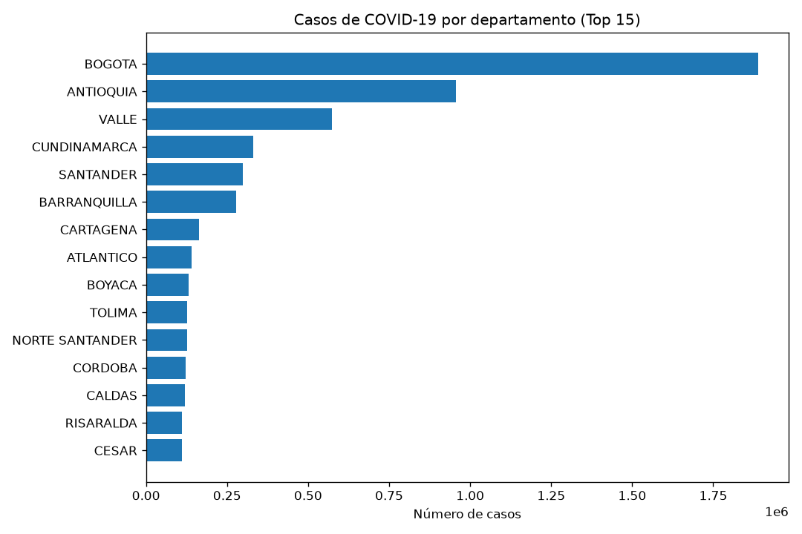
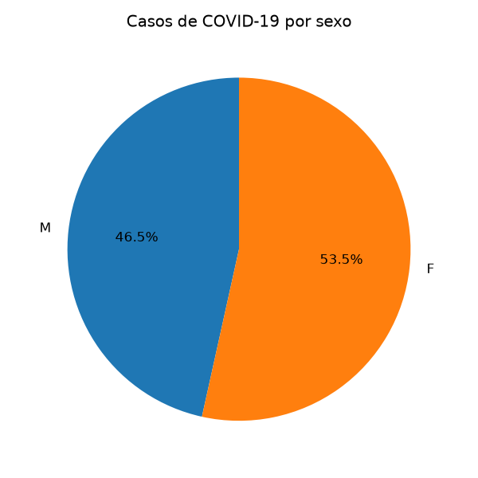
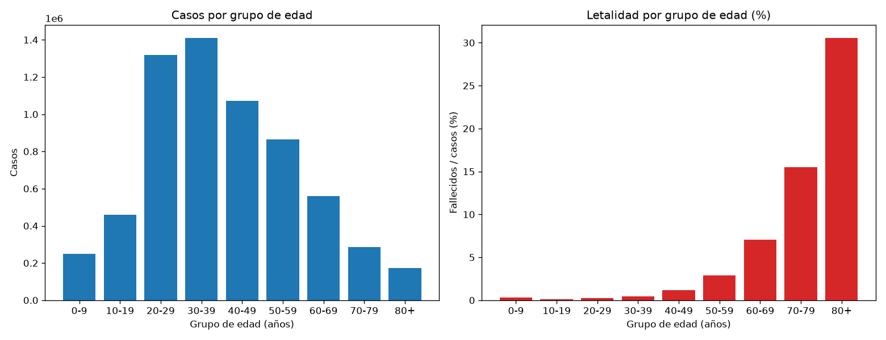
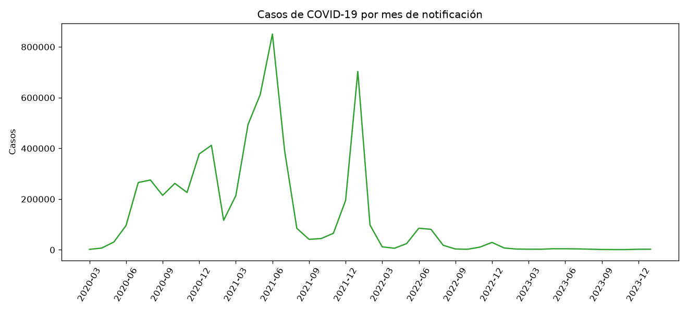
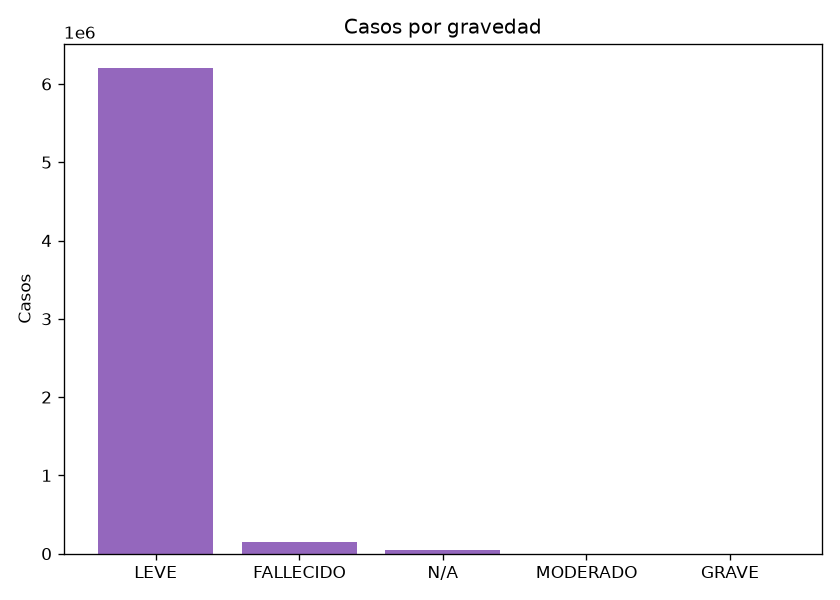
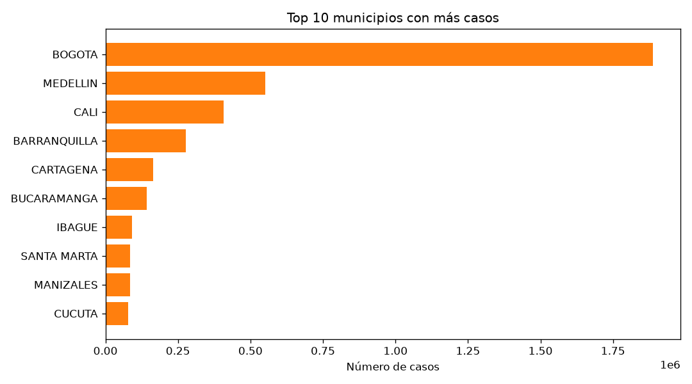

# Análisis de casos de COVID-19 en Colombia con Apache Spark

Proyecto de la Tarea 3 del curso Big Data (202016911), UNAD.
Autora: [TU NOMBRE COMPLETO]

## Problema

¿Cómo se distribuyeron los casos de COVID-19 en Colombia por departamento, sexo, grupo de edad y gravedad, y cuál fue la letalidad por grupo de edad?

## Dataset

- Fuente: Datos Abiertos Colombia (datos.gov.co), Instituto Nacional de Salud, "Casos positivos de COVID-19 en Colombia" (id `gt2j-8ykr`).
- Tamaño: 6.390.971 registros, 23 columnas, 1,2 GB en CSV.
- El archivo no se incluye en el repositorio por su tamaño.

## Requisitos

- Ubuntu 24.04 (WSL2), Java 11, Python 3.12
- `pip install pyspark==3.5.3 pandas matplotlib setuptools`

## Cómo ejecutarlo

1. Descargar el dataset:

```
mkdir -p ~/proyecto_batch/data
cd ~/proyecto_batch/data
wget -O covid_colombia.csv "https://www.datos.gov.co/api/views/gt2j-8ykr/rows.csv?accessType=DOWNLOAD"
```

2. Copiar `batch_covid.py` a `~/proyecto_batch/` y ejecutar:

```
cd ~/proyecto_batch
python3 batch_covid.py
```

3. Prueba rápida con el 2 % de los datos:

```
FRACCION=0.02 python3 batch_covid.py
```

Las gráficas se guardan en `~/proyecto_batch/output/`.

## Qué hace el script

1. **Carga** el CSV original con Spark y renombra las 23 columnas.
2. **Limpia y transforma**: convierte la edad a años, normaliza textos, convierte fechas, marca fallecidos, crea grupos de edad y elimina duplicados y registros inválidos. Guarda el resultado en formato Parquet.
3. **Análisis exploratorio (EDA)**: estadísticas de edad, nulos, casos por departamento, sexo, grupo de edad, mes, gravedad y municipio.
4. **Visualización**: genera 6 gráficas con matplotlib.

## Resultados principales

- Filas originales: 6.390.971. Filas finales: 6.390.955. Descartadas: 16.
- Bogotá concentra la mayor cantidad de casos (1.888.134), seguida de Antioquia y Valle.
- La letalidad aumenta con la edad: 0,15 % entre 10 y 19 años y 30,57 % en mayores de 80.
- Los meses con más casos fueron junio de 2021 (850.536) y enero de 2022 (703.060).
- Fallecidos totales: 184.389.

## Gráficas








## Tiempo real (Anexo 3)

`kafka_producer.py` genera datos simulados de sensores y los envía a Kafka; `spark_streaming_consumer.py` los consume con Spark Structured Streaming y calcula promedios de temperatura y humedad por sensor en ventanas de 1 minuto.
